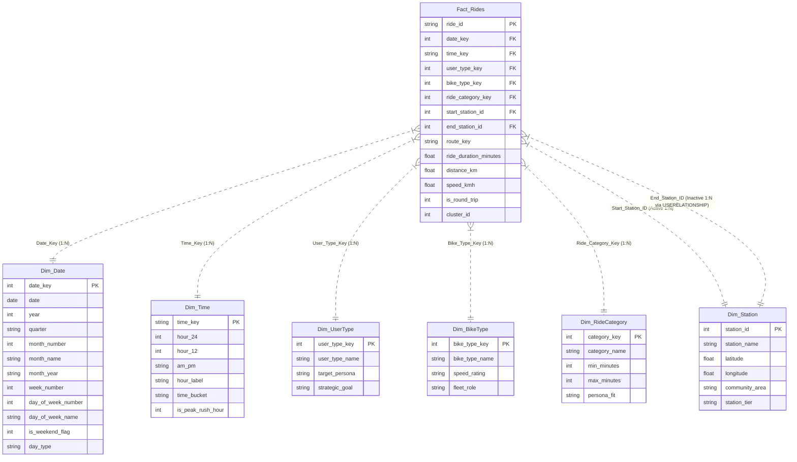

# Cyclistic Bike-Share Analytics — Enterprise Power BI Solution

An end-to-end, production-grade **Microsoft Power BI** solution converted and elevated from the Python exploratory analysis pipeline for Cyclistic Bike-Share (Chicago).

This solution transitions from static matplotlib/seaborn charts to an enterprise **Star Schema data model**, **advanced DAX measure library**, **custom executive theme**, **Power Query ETL transformations**, and a **5-page interactive dashboard suite**.

---

## 🚀 Quick Navigation & Deliverables

| Asset | File / Location | Description |
|---|---|---|
| **Power BI Star-Schema Datasets** | [`data/`](./data/) | Pre-generated, clean CSV tables ready for 1-click Power BI import |
| **Complete DAX Measures Suite** | [`DAX_Measures.dax`](./DAX_Measures.dax) | 35+ production DAX measures grouped into 6 functional folders |
| **Power Query (M) ETL Library** | [`PowerQuery_ETL_Queries.m`](./PowerQuery_ETL_Queries.m) | M scripts matching Python cleaning & dynamic dimension generation |
| **Custom Power BI Theme JSON** | [`cyclistic_theme.json`](./cyclistic_theme.json) | Executive Cyclistic branding palette (Member Blue, Casual Orange, Teal) |
| **Master Solution Blueprint** | [`POWERBI_SOLUTION_BLUEPRINT.md`](./POWERBI_SOLUTION_BLUEPRINT.md) | Page-by-page visual specifications, relationship diagrams, and setup steps |
| **Live Interactive Web Preview** | [`interactive_preview/`](./interactive_preview/) | Interactive digital twin web application simulating the full Power BI report |
| **Real Data Exporter (Python)** | [`export_powerbi_data.py`](./export_powerbi_data.py) | Python utility to convert any raw Divvy/Cyclistic CSV/Parquet into this Star Schema |

---

## 📊 Comparison: Original Visualizations vs. Power BI Solution

| Original Python Visualization | Power BI Transformation & Expansion | Added Dimensions & Intelligence |
|---|---|---|
| `cyclistic_daily_rides_trend.png` (Daily counts) | **Page 1:** Daily & Monthly Trend Dual-Line Visual with **7-Day Moving Average** and zoom slider | MoM & YoY growth calculations, seasonal smoothing, anomaly callouts |
| `cyclistic_user_type_distribution.png` (Static pie) | **Page 1:** Interactive Donut KPI with center metric, cross-filtering all visuals | Instant cross-filtering of all pages by Member vs. Casual |
| `cyclistic_hourly_distribution.png` (Bar chart 0-23) | **Page 2:** Clustered 24-Hour Profile highlighting **twin commuter peaks (8 AM & 5 PM)** vs. **leisure afternoon curve** | Direct comparison between Member and Casual hourly behavior |
| `cyclistic_weekly_trends.png` (Rides by day of week) | **Page 2:** Clustered Day-of-Week Column chart showing Member weekday dominance vs. **Casual weekend surge (+185%)** | Weekend-to-Weekday ratio metrics, commuter share index |
| `cyclistic_ride_duration_summary.png` (Duration stats) | **Page 2:** Trip Duration Buckets (<15m, 15-60m, >60m) + K-Means cluster matrix | Persona mapping (Last-mile transit vs. lakefront leisure cruisers) |
| `cyclistic_station_map.png` & `geographic_distribution.png` | **Page 4:** Chicago Bubble Map + **Net Station Flow (Inflow vs. Outflow)** | Identifies surplus stations vs. deficit stations needing bike rebalancing |
| *(None in original)* | **Page 1:** Vehicle Fleet Adoption (Classic vs. Electric vs. Docked) | Fleet electrification adoption by member category |
| *(None in original)* | **Page 3:** 24x7 Interactive Heatmap Matrix (Day of Week × Hour of Day) | Matrix visual with conditional gradient color formatting |
| *(None in original)* | **Page 4:** Top 8 Origin-Destination Corridors Table | Travel corridors, route keys, round-trip detection |
| *(None in original)* | **Page 5:** Strategic Conversion What-If Simulator + **2D Sensitivity Matrix** | Dynamic parameter sliders for **Conversion Rate %** and **Membership Fee ($)** projecting ARR uplift with 2D sensitivity table |
| *(None in original)* | **Page 6:** Executive Boardroom Briefing & Strategic Storytelling | C-suite briefing slide with 3 core discoveries and 4-point commercial action roadmap |

---

## 🏗️ Data Model Architecture (Star Schema)

The solution follows Microsoft best practices with a normalized Star Schema:

---

## 🛠️ Step-by-Step Instructions to Build in Power BI Desktop

### Step 1: Open Power BI Desktop & Load Data
1. Launch **Power BI Desktop**.
2. Click **Get Data** > **Text/CSV** (or **Folder**).
3. Select the CSV files in [`powerbi/data/`](./data/):
   - `Fact_Rides.csv`
   - `Dim_Date.csv`
   - `Dim_Time.csv`
   - `Dim_Station.csv`
   - `Dim_UserType.csv`
   - `Dim_BikeType.csv`
   - `Dim_RideCategory.csv`
4. Click **Load** (or **Transform Data** to inspect types).

### Step 2: Configure Relationships (Model View)
In Power BI's **Model View**, verify or create single-direction `1-to-Many (*)` relationships:
- `Dim_Date[date_key]` `1` ─── `*` `Fact_Rides[date_key]`
- `Dim_Time[time_key]` `1` ─── `*` `Fact_Rides[time_key]`
- `Dim_UserType[user_type_key]` `1` ─── `*` `Fact_Rides[user_type_key]`
- `Dim_BikeType[bike_type_key]` `1` ─── `*` `Fact_Rides[bike_type_key]`
- `Dim_RideCategory[category_key]` `1` ─── `*` `Fact_Rides[ride_category_key]`
- `Dim_Station[station_id]` `1` ─── `*` `Fact_Rides[start_station_id]` *(Active)*
- `Dim_Station[station_id]` `1` ─── `*` `Fact_Rides[end_station_id]` *(Inactive, invoked via `USERELATIONSHIP` in DAX)*

### Step 3: Import the Custom Theme
1. Navigate to the **View** ribbon tab.
2. In the **Themes** dropdown, click **Browse for themes**.
3. Select [`cyclistic_theme.json`](./cyclistic_theme.json).
4. The dashboard will automatically adopt the executive Cyclistic color palette and styling.

### Step 4: Add DAX Measures
1. On the **Home** ribbon, click **Enter Data** to create a blank table named `_Measures`.
2. Open [`DAX_Measures.dax`](./DAX_Measures.dax).
3. Copy and paste the measures into the `_Measures` table.
4. Assign them to the display folders:
   - `01_Volume_KPIs`
   - `02_Duration_&_Distance`
   - `03_Time_Intelligence`
   - `04_Behavior_Segmentation`
   - `05_Conversion_&_Revenue_Simulation`
   - `06_Station_&_Spatial_Flow`

### Step 5: Add What-If Parameters
1. Navigate to **Modeling** > **New Parameter** > **Numeric range**.
2. **Parameter 1:** `WhatIf_ConversionRate`
   - Min: `0.01` (1%), Max: `0.20` (20%), Increment: `0.005`, Default: `0.07` (7%).
3. **Parameter 2:** `WhatIf_MembershipFee`
   - Min: `89`, Max: `159`, Increment: `5`, Default: `119`.

---

## 🖥️ Live Interactive Preview
To preview the complete multi-page Power BI dashboard immediately in your browser:
- Open [`interactive_preview/index.html`](./interactive_preview/index.html) in any modern web browser or run the local preview server.
- Test interactive slicers, cross-filtering, 24x7 heatmap, and live conversion parameter sliders!
